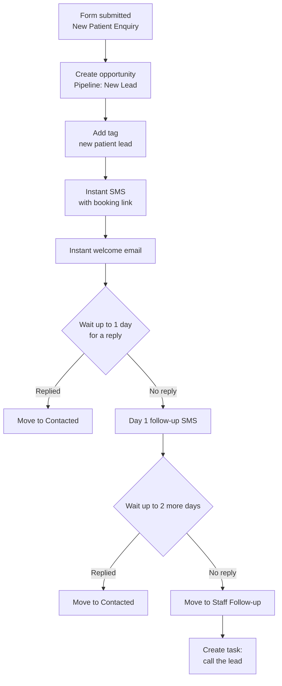

# GoHighLevel Speed-to-Lead Workflow

A real GoHighLevel (GHL) workflow that replies to every new enquiry **in under 60 seconds** and keeps following up until the lead replies, books, or reaches a person.

Built in a GHL practice sub-account for a sample dental clinic, **BrightSmile Dental** (fictional business). The same structure works for spas, law firms, real estate teams, restaurants and home services: only the messages change.

> **Why it matters:** a lead who waits 30 minutes for a reply has usually already contacted someone else. This workflow makes the first reply instant and makes sure nobody is forgotten.

---

## How it works

## Workflow steps

| # | GHL action | Details |
|---|---|---|
| 1 | **Trigger: Form Submitted** | Form: *BrightSmile - New Patient Enquiry* |
| 2 | **Create / update opportunity** | Pipeline *New Patients - Speed to Lead*, stage **New Lead**, name `{{contact.full_name}} - New Patient`, source *Website enquiry form* |
| 3 | **Add tag** | `new patient lead` |
| 4 | **Send SMS** (instant) | Personal reply from "Sara at the front desk" with a one-tap booking link to the GHL calendar |
| 5 | **Send email** (instant) | Welcome email: *Your first visit at BrightSmile Dental* |
| 6 | **Wait for reply** (up to 1 day) | Reply → move to **Contacted** · Timeout → step 7 |
| 7 | **Send SMS** (day 1 follow-up) | Asks whether mornings or afternoons suit them better |
| 8 | **Wait for reply** (up to 2 more days) | Reply → move to **Contacted** · Timeout → step 9 |
| 9 | **Move opportunity** | Stage **No Reply - Staff Follow-up** |
| 10 | **Add task** | *Call the lead*, due in 1 day (skips weekends), with the lead's phone number in the description |

## The messages

**Instant SMS**

> Hi {{contact.first_name}}, thanks for contacting BrightSmile Dental! This is Sara from the front desk. You can pick a time for your first visit here: *[booking link]* Or just reply to this text with a day that suits you. Reply STOP to opt out.

**Day 1 follow-up SMS**

> Hi {{contact.first_name}}, just checking in from BrightSmile Dental. We still have new patient times this week. Would mornings or afternoons suit you better? Reply with either and we'll hold a spot. Reply STOP to opt out.

**Staff task**

> This lead got an instant SMS, a welcome email and a day-1 follow-up but hasn't replied. Give them a friendly call today and offer two times for a first visit. Phone: {{contact.phone}}

## What else is set up in the sub-account

- **Calendar:** *New Patient Visit*, 30-minute slots, weekdays 8:00-17:00
- **Pipeline:** New Lead → Contacted → Booked → No Reply - Staff Follow-up
- **Form:** *BrightSmile - New Patient Enquiry*
- **Conversation AI:** *Sara*, an AI receptionist trained on the clinic's FAQ knowledge base

## Build it in your own GHL account

1. Create the pipeline with the four stages above.
2. Create a calendar and copy its booking link.
3. Create the enquiry form (name, phone, email, reason for visit).
4. Automation → Workflows → **Create workflow** → start from scratch.
5. Add the trigger and actions in the order shown in the table.
6. Paste the messages, swapping in your business name and booking link.
7. Test with your own phone number, then **Publish**.

## Ideas to extend it

- Move the lead to **Booked** automatically when an appointment is created
- Add a WhatsApp message alongside the SMS
- Send a missed-call text-back from the same pipeline
- Hand replies to Conversation AI so it can answer questions and book the slot

---

**Built by Kaynat Umar**, AI automation & GoHighLevel specialist.
Want this running in your GHL account? Message me on [LinkedIn](https://www.linkedin.com/in/kaynat-umar-51960a427) or email kaynatumar@gmail.com.
